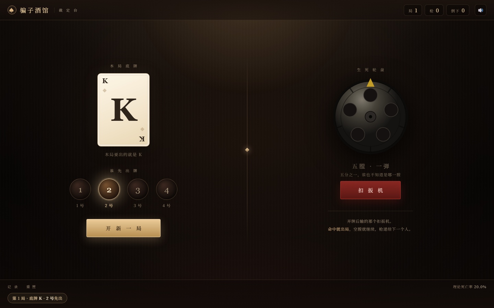
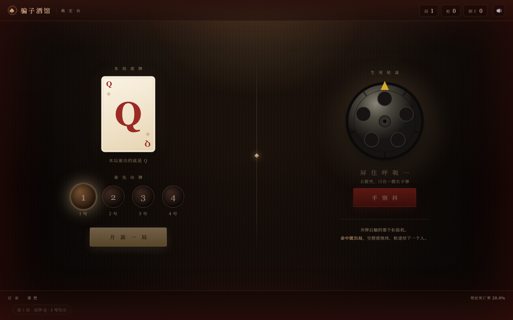

<div align="center">

# 骗子酒馆 · 裁定台

**四个人，一副真扑克，一把左轮。**
这个页面只做三件你们自己决定不了的事。

<br />



<br />

`单文件` · `零依赖` · `离线可用` · `手机 & 桌面`

</div>

---

## 这是什么

线下玩《骗子酒馆》（Liar's Bar）时的**桌上裁定器**。

牌是真牌，谎是真撒，输赢你们自己吵。它只当那个不出声的庄家，负责三件随机事：

| 裁定 | 概率 |
| --- | --- |
| **本局底牌** —— J / Q / K / A 随机一张，这局所有人都得宣称自己出的是它 | 各 25% |
| **谁先出牌** —— 1~4 号里随机一个 | 各 25% |
| **开枪是否命中** —— 五膛弹巢只装一发 | **1/5 = 20%** |

它**不是**电子游戏：没有 AI 对手、不替你们记手牌、不判输赢、也不知道谁在撒谎。出牌规则完全由同桌自己约定，页面不插手。

<br />

## 开枪的压迫感

这不是点一下出个结果的转盘。扣下扳机后有四幕，全程约 4 秒：



**一 · 屏息（1.4s）**
整屏暗下去，一束聚光只打在弹巢上，四角红光随心跳一下一下地跳，低频心跳声响起。按钮文字变成「手 别 抖」。

**二 · 转巢（2s）**
弹巢转动，棘轮咔哒声由急到缓 —— 最后一声「咔」正好卡在弹巢停住的那一帧。

**三 · 死寂（0.5s）**
心跳停了，一声不出。指针压在那个孔上，什么都不响。

**四 · 揭晓**
命中：全屏红闪、枪响、弹巢后坐，红孔亮起，「砰 —— 出局」。
空膛：弹巢泛一下暖光，像绷紧的弦松开，「咔哒 —— 空膛」。

> 桌上玩的时候把设备放桌子正中间、音量 60% 左右。心跳和最后那声「咔」在安静房间里的效果，比盯着屏幕强得多。

<br />

## 怎么用

**最省事**：双击 `index.html`，用浏览器打开。不用装任何东西，断网也能跑。

**手机上**：把文件丢进手机（或用 GitHub Pages / 任意静态托管），同一个人操作，或者把手机摆桌子中间。

**本地起服务**（可选，方便手机通过局域网访问）：

```bash
python -m http.server 8000
# 电脑访问 http://localhost:8000
# 手机访问 http://<电脑局域网IP>:8000
```

### 快捷键

| 键 | 作用 |
| --- | --- |
| `空格` | 开新一局（翻底牌 + 抽先手） |
| `回车` | 扣扳机 |

<br />

## 一些细节

- **数据会留存**：局数、枪数、倒下数、最近 80 条记录存在 `localStorage`，刷新不丢。右下角「重置」清空。
- **理论 vs 实测**：记录条右侧会同时显示理论死亡率和本次实测，长期开着能看到它收敛到 20%。
- **音效是实时合成的**：用 Web Audio 现场生成，没有任何音频文件。右上角喇叭可以静音。
- **响应式**：桌面左右双栏；手机单列，轮盘改成横向排布，一屏放得下。

<br />

## 想改点什么

几个常量都在 `<script>` 顶部：

```js
const RANKS = ["J", "Q", "K", "A"];  // 底牌点数
const CHAMBERS = 5;                  // 弹巢膛数 → 死亡率 = 1/CHAMBERS
const STEP = 360 / CHAMBERS;
const RATE_TEXT = (100 / CHAMBERS).toFixed(1) + "%";
```

- **改膛数**：改 `CHAMBERS` 之后，还要同步 SVG 里 `<g id="cylG">` 的五个 `<circle class="chamber">` 坐标和外圈齿痕，否则指针会对不齐。
- **改底牌范围**：改 `RANKS` 数组即可，界面会自动适配。
- **改人数**：HTML 里 `.seats` 下的 `.pseat` 数量、以及 `spinSeats()` 的轮转逻辑需要一起调整。

<br />

## 技术

纯 HTML / CSS / JavaScript，一个文件，没有框架、没有构建、没有外部请求。

- 弹巢用内联 SVG 绘制，转动靠 CSS `transform` + 自定义缓动曲线
- 随机全部走 `Math.random()`，概率在代码里一目了然，可以直接审
- 音效由 `OscillatorNode` / 噪声缓冲实时合成

<br />

## License

MIT —— 拿去玩，改成你们自己的规则都行。
